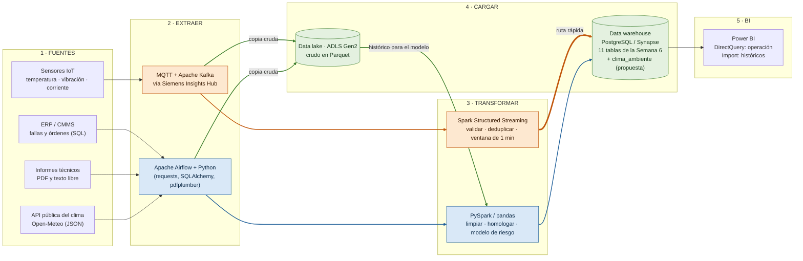

# Actividad Práctica — Semana 8
## Diseña un pipeline ETL

**Estudiante:** Cristhian Gaitán Guzmán
**Programa:** Facultad de Ingeniería, Corporación Universitaria del Huila (CORHUILA)
**Asignatura:** Ciencia de Datos (Cód. 69109) · Pénsum 40D · Grupo 1
**Docente:** Jesús Ariel Gonzáles Bonilla
**Unidad / Corte:** Unidad 2 — Modelamiento, transformación y conexión de datos · Semana 8 · Corte 2
**Fecha:** Octubre de 2026

---

## 1. Caso

Seguimos con el mantenimiento predictivo de motores y equipos industriales en una planta de Siemens (Semanas 1 a 7). Ya existen el inventario de fuentes (Semana 2), la arquitectura (Semana 3), las preguntas analíticas (Semana 4), el ERD de 11 tablas (Semana 6) y las consultas sobre ese modelo (Semana 7). Falta lo que une todo: **cómo llegan los datos, ya limpios, a esas 11 tablas** y de ahí al tablero. Eso es el pipeline ETL.

> **Nota:** el diseño es **ilustrativo**. Las herramientas son candidatas, coherentes con las de la Semana 3; no se implementó la planta completa. Lo único implementado y probado es el mini-ETL del punto 4 (API pública). Las latencias de la sección 3 son **supuestos de diseño**, no mediciones.

---

## 2. Punto 1 — Pipeline ETL con herramienta por etapa

### 2.1 Diagrama



**Cómo leerlo.** Todo el diagrama usa líneas continuas; el color indica el tipo de flujo. Naranja = ruta *streaming* (la línea más gruesa es la de baja latencia hacia el warehouse); azul = ruta *batch*; verde = almacenamiento, es decir, la copia cruda al data lake y el histórico que el lake devuelve al modelo. Las dos rutas terminan en el **mismo** warehouse, así que Power BI consulta un solo modelo.

### 2.2 Herramienta por etapa

| Etapa | Qué ocurre | Herramienta | Por qué esa (y alternativa) |
|---|---|---|---|
| **1 · Fuentes** | Sensores IoT (lecturas JSON por MQTT), ERP/CMMS (SQL), informes técnicos (texto libre), API del clima (JSON) | — | Son las fuentes estructuradas, semiestructuradas y no estructuradas clasificadas en la Semana 2 |
| **2 · Extraer** (sensores) | Los sensores publican sin esperar a quien consume; el broker guarda los mensajes | MQTT + Apache Kafka, vía Siemens Insights Hub | Kafka retiene los mensajes en un registro, así que si el transformador falla se **reprocesa** sin perder lecturas. Alternativa: Azure Event Hubs |
| **2 · Extraer** (ERP, informes, clima) | Consultas **incrementales** (solo filas nuevas o modificadas desde la última corrida), descarga de los PDF de informes y consulta de la API del clima | Apache Airflow + Python (`SQLAlchemy`, `requests`, `pdfplumber`) | Airflow programa tareas y encadena dependencias; el código es Python, que ya se usa en el curso. `pdfplumber` extrae el texto de los informes que son PDF con texto; si fueran escaneados haría falta OCR (por ejemplo, Azure AI Document Intelligence). Alternativa a Airflow: Azure Data Factory |
| **3 · Transformar** (streaming) | Validar rango físico, eliminar duplicados por `(id_sensor, fecha_hora)`, tolerar datos tardíos y **promediar por ventanas de 1 minuto** | Spark Structured Streaming | Es el mismo motor que la ruta batch (Semana 3 ya eligió Spark): un solo conjunto de habilidades y de código para las dos rutas |
| **3 · Transformar** (batch) | Homologar códigos de equipo, quitar duplicados, **marcar** vacíos y valores imposibles, unir el clima, **leer del lake el histórico de sensores**, calcular variables y correr el modelo → `prediccion_riesgo` | PySpark o pandas + scikit-learn | El volumen del ERP es pequeño: pandas basta; se pasa a PySpark solo si crece. El histórico de sensores es mayor y viene en Parquet, así que ahí PySpark sí se justifica |
| **4 · Cargar** (lake) | Copia **cruda e inmutable** de todo lo extraído (los PDF originales se guardan tal cual; lo demás, en Parquet) | Azure Data Lake Storage Gen2 | Permite auditar y volver a procesar con reglas nuevas; es la trazabilidad que pedía el riesgo ético de la Semana 4 |
| **4 · Cargar** (warehouse) | Las 11 tablas del ERD de la Semana 6, con *upsert* y en orden que respete las llaves foráneas | PostgreSQL (prototipo) / Synapse o Snowflake (escala) | Coincide con el `schema.sql` ya entregado y con la arquitectura de la Semana 3 |
| **5 · BI** | Riesgo por equipo, fallas, órdenes, estado en vivo | Power BI | *DirectQuery* en el panel de operación (se ve el dato casi al instante) e *Import* con actualización programada en los históricos |
| **Transversal** | Orquestación, pruebas de calidad, alertas del propio pipeline | Airflow + reglas de calidad en el código | Un pipeline que falla en silencio es peor que uno que falla a la vista |

### 2.3 Reglas de transformación (de dónde salen)

| Regla | Ruta | Origen de la regla |
|---|---|---|
| Rango físico esperado de temperatura y vibración | Streaming | Semana 2: detectar sensores descalibrados |
| Duplicados por `(id_sensor, fecha_hora)` | Streaming | Es la restricción `UNIQUE` del ERD (Semana 6): la regla de limpieza y la restricción de la base coinciden |
| Nombres de equipo y de máquina escritos de varias formas (`M-01`, `m-01`, `M01`) | Batch | Taller de la Semana 8: `strip`, `upper` y homologación |
| Vacíos y valores imposibles: **se marcan, no se inventan ni se borran del crudo** | Ambas | Semana 8: la fila con 11 600 unidades se retiró del dato limpio, pero se conserva en el crudo; aquí el crudo vive en el lake |
| Fechas a `datetime` y zona horaria única | Ambas | ERD: `TIMESTAMPTZ` |

### 2.4 Qué alimenta cada tabla del ERD

| Tabla(s) del ERD | Fuente | Ruta |
|---|---|---|
| `linea_produccion`, `equipo`, `tipo_falla`, `tecnico` | ERP/CMMS (maestros) | Batch |
| `tipo_medicion`, `sensor` | Catálogo de activos de Insights Hub | Batch (cambia poco) |
| `lectura_sensor` | Sensores IoT, promedio por ventana de 1 min | **Streaming** |
| `falla`, `orden_mantenimiento`, `asignacion_tecnico` | ERP/CMMS (transacciones) | Batch |
| `prediccion_riesgo` | Salida del modelo | Batch |
| `orden_mantenimiento.ruta_informe` | Informes técnicos (solo se guarda la ruta, como en la Semana 6) | Batch |
| `clima_ambiente` (nueva, propuesta) | API pública del clima | Batch (punto 4) |

> Las 11 tablas son las del ERD de la Semana 6; `clima_ambiente` sería la tabla 12, **propuesta nueva** que no existe en ese modelo.

**Orden de carga:** maestros → sensores → fallas y predicciones → órdenes → asignaciones. Si se invierte, las llaves foráneas rechazan las filas (lo mismo que se vio en la Semana 7 con la FK compuesta).

---

## 3. Punto 2 — Qué es batch, qué es streaming y por qué

**Criterio.** No se elige por moda sino por una pregunta: *¿cuánto cuesta esperar por este dato?* Si una decisión pierde valor en minutos, se paga la complejidad del streaming; si no, el batch es más simple, más barato y más fácil de reprocesar.

| Flujo | Modo | Latencia objetivo (supuesto) | Justificación |
|---|---|---|---|
| Lecturas de sensores → alertas y panel de operación | **Streaming** | ~1 minuto | Un pico de vibración o de temperatura sirve si se ve mientras el motor sigue funcionando; enterarse al día siguiente no evita la parada. Es el único flujo continuo y de alta velocidad (la «V» de velocidad de la Semana 2) |
| Lecturas de sensores → histórico para el modelo | **Batch** (desde el lake) | Diaria | El entrenamiento y las variables históricas no necesitan el dato al segundo; se leen del lake en bloque |
| ERP/CMMS: fallas, órdenes, técnicos | **Batch** | Diaria, de madrugada | Es un sistema transaccional: consultarlo cada segundo lo cargaría sin ganancia, porque las órdenes cambian de estado por turno o por día. Además un corte diario da una foto consistente |
| Modelo de riesgo → `prediccion_riesgo` | **Batch** | Diaria, después de la carga del ERP | El modelo predice la falla en los **próximos 15 días** (Semana 4); recalcular cada día es más que suficiente |
| Informes técnicos | **Batch** | Diaria | Aparecen al cerrar una orden y son texto libre; no hay nada que reaccionar en segundos |
| API del clima | **Batch** | Cada hora | La fuente publica datos por hora; consultarla más seguido no trae información nueva y sí choca con sus límites de uso |

**Por qué los sensores usan las dos rutas.** Los mismos datos cumplen dos funciones: vigilar (necesita rapidez) y aprender (necesita historia completa). Por eso el broker alimenta a la vez el procesamiento en streaming y la copia cruda del lake. Es la idea de una ruta rápida y una ruta de histórico que convergen en el mismo warehouse.

**Por qué no todo en streaming.** Cada pieza continua añade costo y modos de falla: hay que mantener el procesador encendido, vigilar el retraso y manejar datos fuera de orden. Para el ERP o el modelo eso no compra nada.

**Riesgos del streaming y cómo se controlan.**

- **Datos tardíos o desordenados** (un sensor reconecta y envía lecturas viejas): *watermark* en Spark, que fija hasta cuándo se aceptan.
- **Duplicados por reintentos:** la restricción `UNIQUE (id_sensor, fecha_hora)` y la carga con *upsert* hacen que reenviar una lectura no la duplique.
- **Fallas del procesador:** Kafka retiene los mensajes y el lake guarda el crudo, así que se puede reprocesar.
- **Matiz técnico:** Spark Structured Streaming trabaja por defecto en micro-lotes. Eso sirve para latencias de segundos a un minuto, que es lo que este caso necesita; no se justifica un motor de milisegundos.

---

## 4. Punto 3 (opcional) — Consumir una API pública con `requests`

**API elegida:** Open-Meteo (pronóstico y datos recientes por hora, sin llave de acceso). **Por qué:** la temperatura ambiente influye en la temperatura de operación de un motor, así que es una variable de contexto natural para la pregunta diagnóstica de la Semana 4 (picos de temperatura antes de una falla). La ubicación del script (Neiva) es ilustrativa y se cambia en dos constantes.

El script `api_clima.py` hace en pequeño lo que el pipeline hace en grande:

| Paso | Función | Qué hace |
|---|---|---|
| Extraer | `extraer()` | `requests.get` con `timeout` y `raise_for_status()`: un error HTTP detiene el flujo en vez de dejar pasar datos corruptos |
| Transformar | `transformar()` | Descarta las horas futuras (son pronóstico, no dato), marca `ok`, `sin_dato` o `fuera_de_rango` sin borrar ni inventar |
| Cargar | `cargar()` | *Upsert* en SQLite: correrlo dos veces no duplica filas |
| Mostrar | `mostrar()` | Imprime los 3 registros más recientes |

```python
params = {
    "latitude": 2.9273, "longitude": -75.2819,
    "hourly": "temperature_2m,relative_humidity_2m",
    "past_days": 1, "forecast_days": 1, "timezone": "America/Bogota",
}
respuesta = requests.get("https://api.open-meteo.com/v1/forecast", params=params, timeout=15)
respuesta.raise_for_status()
```

**Cómo ejecutarlo** (PowerShell o terminal):

```bash
pip install requests
python api_clima.py
```

(El script `ejecutar_y_entregar.ps1` hace esto, corre las pruebas y pega la salida real en este bloque; el detalle está en el `README.md`.)

**Salida de la ejecución (3 registros):**

```text
$ python api_clima.py
# ejecutado el 2026-10-16 19:21 (hora local)
Extraídas 44 horas (hasta ahora). Calidad: {'ok': 44}

fecha_hora           temperatura_c  humedad_pct  calidad
2026-10-16 17:00:00           29.0         61.0  ok
2026-10-16 18:00:00           28.0         69.0  ok
2026-10-16 19:00:00           27.9         69.0  ok

Cargado en clima.db: 44 filas nuevas, 0 actualizadas.
```

**Dos advertencias honestas.** (1) Los valores «recientes» de esta API son estimaciones de un modelo meteorológico, no mediciones de una estación física. (2) Según su documentación, Open-Meteo es gratuita para uso no comercial; en una planta real habría que usar un plan comercial o datos de una estación (por ejemplo, del IDEAM).

---

## 5. Conclusión

El pipeline separa las rutas según cuánto vale esperar: **streaming solo para las lecturas de los sensores**, porque ahí la rapidez permite actuar antes de la parada, y **batch para todo lo demás**, porque el ERP, el modelo de 15 días, los informes y el clima no ganan nada con la complejidad continua. Las dos rutas desembocan en el warehouse del ERD de la Semana 6, con las mismas restricciones (`UNIQUE`, llaves foráneas) que ya validaron las consultas de la Semana 7. Y el crudo se conserva siempre en el lake: lo que se marca como dudoso hoy puede revisarse mañana, el mismo criterio de «hueco honesto» del taller de limpieza.

---

## Referencias

[1] Apache Software Foundation, «Structured Streaming Programming Guide,» *Apache Spark Documentation*. [En línea]. Disponible: https://spark.apache.org/docs/latest/structured-streaming-programming-guide.html

[2] Apache Software Foundation, «Apache Kafka Documentation.» [En línea]. Disponible: https://kafka.apache.org/documentation/

[3] Apache Software Foundation, «Apache Airflow Documentation.» [En línea]. Disponible: https://airflow.apache.org/docs/

[4] Open-Meteo, «Weather Forecast API.» [En línea]. Disponible: https://open-meteo.com/en/docs

[5] K. Reitz, «Requests: HTTP for Humans,» *Requests Documentation*. [En línea]. Disponible: https://requests.readthedocs.io/

[6] R. Kimball y M. Ross, *The Data Warehouse Toolkit: The Definitive Guide to Dimensional Modeling*, 3.ª ed. Hoboken, NJ, EE. UU.: Wiley, 2013.

[7] Microsoft, «Introduction to Azure Data Lake Storage Gen2,» *Microsoft Learn*. [En línea]. Disponible: https://learn.microsoft.com/azure/storage/blobs/data-lake-storage-introduction
