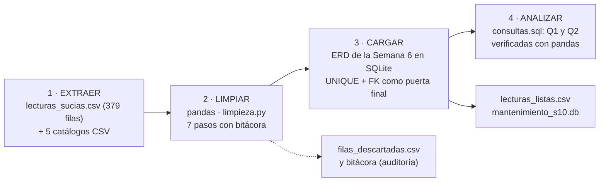
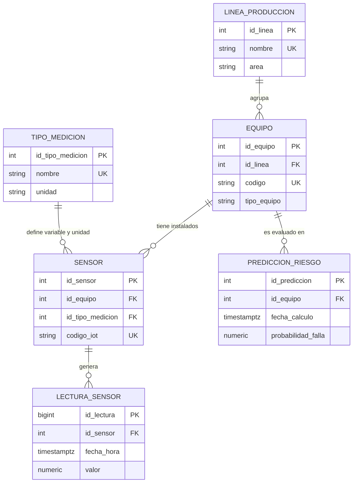

# Actividad Práctica — Semana 10
## Mini-proyecto de datos (cierre del Corte 2)

**Estudiante:** Cristhian Gaitán Guzmán
**Programa:** Facultad de Ingeniería, Corporación Universitaria del Huila (CORHUILA)
**Asignatura:** Ciencia de Datos (Cód. 69109) · Pénsum 40D · Grupo 1
**Docente:** Jesús Ariel Gonzáles Bonilla
**Unidad / Corte:** Unidad 2 — Modelamiento, transformación y conexión de datos · Semana 10 · Corte 2
**Tipo:** Formativa, opcional, sin nota en Moodle · individual · periodo 2026-B
**Fecha:** Octubre de 2026

---

## 1. Caso y alcance

Seguimos con el mantenimiento predictivo en una planta de Siemens (Semanas 1 a 9). Este mini-proyecto **junta en un solo flujo lo que se construyó en el corte**: el ERD de la Semana 6 es el destino de los datos, las consultas de la Semana 7 son el análisis, el pipeline ETL de la Semana 8 es el diseño que se implementa en pequeño, y la limpieza de la Semana 9 es la etapa del medio.

> **Nota:** los datos son **sintéticos e ilustrativos**. Las lecturas son las de la Semana 9 (`lecturas_sucias.csv`, 379 filas) y los catálogos (líneas, equipos, sensores, predicciones de riesgo) son los de la Semana 7. Los umbrales usados (70 °C, y 0,70 / 0,40 de la vista de riesgo) son **supuestos de ilustración**. La fuente de este proyecto es un CSV; la API del clima de la Semana 8 queda como una segunda fuente posible.

| Punto de la guía | Pts | Dónde se resuelve |
|---|---|---|
| Modelo (ERD) + carga + limpieza | 50 | §3 (ERD) y §4 (limpieza y carga) · `schema.sql`, `limpieza.py`, `pipeline_semana10.py` |
| 2 análisis con consultas (filtro + agregación) | 35 | §5 · `consultas.sql` |
| Datos listos y flujo documentado (extraer → limpiar → analizar) | 15 | §2 (flujo) y §6 (datos listos) |

## 2. El flujo: extraer → limpiar → cargar → analizar



| Etapa | Qué hace | Función / archivo | Salida |
|---|---|---|---|
| **1 · Extraer** | Lee las lecturas **como texto** (`dtype=str`, sin que pandas decida qué es nulo) y los 5 catálogos | `extraer()` | `bruto` (379 × 6) y 5 tablas maestras |
| **2 · Limpiar** | Normaliza texto, corrige tipos, quita duplicados, imputa por regla, convierte °F y aparta imposibles | `limpiar()` → `limpieza.py` | 338 filas, bitácora y filas descartadas |
| **3 · Cargar** | Crea las 11 tablas del ERD con las llaves foráneas activas, carga catálogos y luego las lecturas | `cargar()` | `mantenimiento_s10.db` |
| **4 · Analizar** | Ejecuta las 2 consultas y compara cada una contra su versión en pandas | `analizar()` → `consultas.sql` | `q1_*.csv`, `q2_*.csv`, `lecturas_listas.csv` |

**Dos reglas del flujo.** (1) El orden de la limpieza importa: se normaliza el texto *antes* de buscar duplicados, porque 6 de ellos solo se ven así. (2) Lo dudoso se **aparta con su motivo, no se arregla ni se borra en silencio**: queda en `filas_descartadas.csv`.

## 3. Punto 1 — Modelo de datos (ERD)

El destino es el **mismo ERD de la Semana 6**, sin cambios (`schema.sql`, 11 tablas). Para este mini-proyecto se usan 6 de ellas; el diagrama muestra solo esas.



| Tabla | Papel en este proyecto | Filas cargadas |
|---|---|---:|
| `linea_produccion`, `tipo_medicion`, `equipo`, `sensor` | Catálogos: dicen a qué equipo y variable pertenece cada lectura | 3, 2, 6 y 12 |
| `lectura_sensor` | **Destino de los datos limpios** | 338 |
| `prediccion_riesgo` + vista `v_riesgo_actual` | Salida del modelo de riesgo; se cruza en la consulta Q2 | 12 |
| `tipo_falla`, `tecnico`, `falla`, `orden_mantenimiento`, `asignacion_tecnico` | Existen en el esquema pero **quedan vacías**: estas preguntas no las necesitan | 0 |

**La clave `UNIQUE (id_sensor, fecha_hora)` funciona como control de calidad.** Es la misma regla que la limpieza aplica como «duplicado por clave» (fecha, equipo, tipo), así que si algún duplicado se hubiera escapado, la base lo rechazaría al cargar. Lo mismo hacen las llaves foráneas con una lectura de un sensor que no existe.

## 4. Punto 2 — Carga y limpieza

### 4.1 Antes / después de la limpieza

Se midió con una sola función (`calidad()`) sobre el archivo original y sobre el limpio, ambos leídos como texto.

| Métrica | Antes | Después |
|---|---:|---:|
| Filas | 379 | **338** |
| Nulos (celdas vacías, `N/A`, `--`) | 49 | **0** |
| Duplicados por clave (fecha, equipo, tipo) | 19 | **0** |
| Completitud | 97,8 % | 100 % |
| Unicidad | 95,0 % | 100 % |
| Consistencia | 35,9 % | 100 % |
| Formato | 62,8 % | 100 % |
| Validez | 91,5 % | 100 % |

| # | Paso | Filas | Valores corregidos |
|---|---|---|---:|
| 1 | Normalizar texto (`strip`, mayúsculas, acentos, sinónimos) | 379 → 379 | 304 |
| 2 | Tipos: fecha a `datetime` y valor a número (coma decimal) | 379 → 379 | 147 |
| 3 | Quitar duplicados por clave (13 exactos + 6 que solo se ven tras normalizar) | 379 → 360 | 0 |
| 4 | Imputar por regla: unidad, tipo y turno | 360 → 360 | 35 |
| 5 | Eliminar filas sin valor medido (la medida no se inventa) | 360 → 348 | 0 |
| 6 | Convertir °F a °C | 348 → 348 | 12 |
| 7 | Apartar valores imposibles (fuera del rango físico del sensor) | 348 → 338 | 0 |

Los criterios de fondo (imputar con reglas y no con promedios, apartar los imposibles en lugar de adivinarlos) son los de la Semana 9 y están justificados allí; aquí se reutilizan tal cual a través de `limpieza.py`. El resultado es **idéntico, byte a byte**, al `lecturas_limpias.csv` de la Semana 9.

### 4.2 Carga al ERD

1. **Catálogos primero**, en el orden que respetan las llaves foráneas: `linea_produccion` → `tipo_medicion` → `equipo` → `sensor` → `prediccion_riesgo`.
2. **De texto a identificador.** La lectura limpia trae `equipo` (por ejemplo `COM-B-003`) y `tipo_medicion` (`temperatura`); la tabla `lectura_sensor` necesita `id_sensor`. Se obtiene uniendo con `equipo` y `tipo_medicion`, con `merge(..., validate="m:1")` y un `assert` de que ninguna lectura queda sin sensor.
3. **Lecturas** con `fecha_hora` en texto ISO y `valor` numérico: 338 filas.

**Pruebas negativas** (la base rechaza lo que la limpieza debió impedir):

| Intento | Resultado |
|---|---|
| Insertar una lectura repetida del mismo sensor y el mismo instante | Rechazada: `UNIQUE constraint failed: lectura_sensor.id_sensor, lectura_sensor.fecha_hora` |
| Insertar una lectura de un sensor que no existe (`id_sensor = 99`) | Rechazada: `FOREIGN KEY constraint failed` |

## 5. Punto 3 — Dos análisis con consultas

Ambas combinan **filtro** (`WHERE`) y **agregación** (`GROUP BY`), están en `consultas.sql` y se verificaron contra una versión en pandas con `assert_frame_equal`.

### 5.1 Q1 — ¿Qué equipos operan más calientes y con qué frecuencia superan 70 °C?

```sql
SELECT e.codigo AS equipo,
       COUNT(*)                                       AS n_lecturas,
       ROUND(AVG(l.valor), 2)                         AS temp_promedio,
       ROUND(MAX(l.valor), 2)                         AS temp_maxima,
       SUM(CASE WHEN l.valor >= 70 THEN 1 ELSE 0 END) AS n_sobre_70,
       ROUND(100.0 * SUM(CASE WHEN l.valor >= 70 THEN 1 ELSE 0 END) / COUNT(*), 1) AS pct_sobre_70
FROM   lectura_sensor AS l
JOIN   sensor         AS s ON s.id_sensor = l.id_sensor
JOIN   tipo_medicion  AS t ON t.id_tipo_medicion = s.id_tipo_medicion
JOIN   equipo         AS e ON e.id_equipo = s.id_equipo
WHERE  t.nombre = 'temperatura'
GROUP  BY e.codigo
ORDER  BY temp_promedio DESC, equipo;
```

| equipo | n_lecturas | temp_promedio (°C) | temp_maxima (°C) | n_sobre_70 | pct_sobre_70 |
|---|---:|---:|---:|---:|---:|
| COM-B-003 | 29 | 78,46 | 85,74 | 29 | 100,0 |
| MOT-C-005 | 28 | 65,61 | 68,62 | 0 | 0,0 |
| MOT-A-001 | 30 | 61,93 | 65,43 | 0 | 0,0 |
| MOT-B-004 | 27 | 59,79 | 62,96 | 0 | 0,0 |
| MEZ-C-006 | 28 | 57,85 | 62,00 | 0 | 0,0 |
| BOM-A-002 | 26 | 54,80 | 57,03 | 0 | 0,0 |

**¿Qué responde?** El compresor `COM-B-003` es el único que opera caliente: sus 29 lecturas de temperatura están en 70 °C o más y su promedio (78,46 °C) está casi 13 °C por encima del siguiente equipo. Ningún otro supera 70 °C. **Cuidado al leerlo:** el contraste es tan limpio porque el dataset sintético se construyó con una deriva de temperatura en ese compresor; con datos reales no esperaría una separación así.

### 5.2 Q2 — ¿Los equipos que el modelo marca con más riesgo son también los que más vibran?

```sql
SELECT e.codigo AS equipo, r.nivel_riesgo, r.probabilidad_falla,
       COUNT(*)               AS n_lecturas,
       ROUND(AVG(l.valor), 2) AS vib_promedio,
       ROUND(MAX(l.valor), 2) AS vib_maxima
FROM   lectura_sensor  AS l
JOIN   sensor          AS s ON s.id_sensor = l.id_sensor
JOIN   tipo_medicion   AS t ON t.id_tipo_medicion = s.id_tipo_medicion
JOIN   equipo          AS e ON e.id_equipo = s.id_equipo
JOIN   v_riesgo_actual AS r ON r.id_equipo = e.id_equipo
WHERE  t.nombre = 'vibracion'
GROUP  BY e.codigo, r.nivel_riesgo, r.probabilidad_falla
ORDER  BY vib_promedio DESC, equipo;
```

| equipo | nivel_riesgo | probabilidad_falla | n_lecturas | vib_promedio (mm/s) | vib_maxima (mm/s) |
|---|---|---:|---:|---:|---:|
| COM-B-003 | Alto | 0,91 | 28 | 5,49 | 6,48 |
| MEZ-C-006 | Alto | 0,78 | 30 | 3,52 | 4,09 |
| BOM-A-002 | Bajo | 0,31 | 29 | 3,16 | 3,61 |
| MOT-C-005 | Medio | 0,52 | 26 | 2,87 | 3,22 |
| MOT-A-001 | Bajo | 0,15 | 28 | 2,36 | 2,74 |
| MOT-B-004 | Bajo | 0,10 | 29 | 2,27 | 2,82 |

**¿Qué responde?** **En parte.** Los dos equipos con riesgo *Alto* (`COM-B-003` y `MEZ-C-006`) son también los dos que más vibran, y la consulta Q1 añade que el primero además es el más caliente: las tres lecturas apuntan al mismo equipo. Pero el acuerdo no es total: `BOM-A-002` (riesgo *Bajo*, 0,31) vibra más que `MOT-C-005` (riesgo *Medio*, 0,52). Puede deberse a que un modelo de riesgo suele usar más variables que la vibración, pero conviene revisarlo antes de confiar en el nivel *Medio*. Es una **asociación entre dos listas, no una prueba** de que la vibración cause el riesgo.

**Una advertencia sobre los conteos.** `n_lecturas` va de 26 a 30 por equipo (lo esperado son 30) porque la limpieza apartó 22 filas. Los promedios son comparables, pero no todos se calcularon con las mismas lecturas.

## 6. Datos listos para analizar

| Archivo | Contenido |
|---|---|
| `salida/mantenimiento_s10.db` | Base SQLite con el ERD de la Semana 6 y las 338 lecturas cargadas |
| `salida/lecturas_listas.csv` | Tabla plana lista para analizar: `fecha_hora, equipo, tipo_medicion, valor, unidad` (338 filas) |
| `salida/lecturas_limpias.csv` | Salida de la limpieza, con la columna `ajustes` que marca qué se imputó o convirtió |
| `salida/filas_descartadas.csv` | Las 22 filas apartadas con su motivo (12 sin valor, 10 fuera de rango físico) |
| `salida/bitacora_limpieza.csv`, `salida/antes_despues.csv` | Evidencia de la limpieza |
| `salida/q1_temperatura_por_equipo.csv`, `salida/q2_vibracion_vs_riesgo.csv` | Resultados de las dos consultas |

## 7. Qué se verificó (y qué no)

| Verificación | Resultado |
|---|---|
| Ejecutar `python pipeline_semana10.py` dos veces | Salida idéntica; coincide con `salida_esperada.txt` |
| La limpieza frente a la de la Semana 9 | `lecturas_limpias.csv` idéntico byte a byte (mismo código, mismo resultado) |
| Filas en `lectura_sensor` frente a las filas limpias | 338 = 338 |
| Pruebas negativas (lectura repetida y sensor inexistente) | Ambas rechazadas por la base |
| Q1 y Q2 en SQL frente a pandas | Idénticas (`assert_frame_equal`, tolerancia de 0,011 por el redondeo) |
| **No verificado** | Ejecución en un servidor PostgreSQL real (solo SQLite, como en la Semana 7); que los límites físicos y el umbral de 70 °C correspondan a un sensor real; que el flujo aguante un archivo real de la planta, que traería errores que aquí no se previeron |

Probado con Python 3.12.3, pandas 3.0.2 y SQLite 3.45.1.

## Conclusión

El mini-proyecto muestra que las piezas del corte no eran ejercicios sueltos sino un solo flujo: la limpieza deja el dato apto, el ERD lo recibe y **lo vigila con sus propias restricciones** (la clave `UNIQUE` repite la regla de duplicados y las llaves foráneas rechazan lo huérfano), y las consultas responden preguntas del caso. Las dos respuestas se complementan: el compresor `COM-B-003` es el más caliente (Q1), el que más vibra y el de mayor riesgo (Q2), es decir, una candidata clara a mantenimiento predictivo. También dejan una lección de honestidad: el modelo de riesgo y los sensores coinciden en los extremos, pero no en el medio (`BOM-A-002` frente a `MOT-C-005`), y eso es lo que habría que revisar primero.

## Entrega

- **Carpeta:** `10-week/02-optional-activity/` (el parcial práctico del corte sigue en `10-week/c2-practical-exam/` sin cambios).
- **Archivos:** este documento, `pipeline_semana10.py`, `limpieza.py`, `consultas.sql`, `schema.sql` (el de la Semana 6), `salida_esperada.txt`, `datos/` (entrada: 6 CSV) y `salida/` (resultados: 8 archivos).
- **Cómo reproducir:** `cd 10-week/02-optional-activity` · `pip install pandas` · `python pipeline_semana10.py`.
- `git add .` · `git commit -m "Entrega actividad opcional semana 10"` · `git push`
- Actividad formativa y opcional (sin nota en Moodle).

## Referencias

[1] W. McKinney, "Data structures for statistical computing in Python," in *Proc. 9th Python in Science Conf. (SciPy 2010)*, 2010, pp. 56–61.

[2] SQLite Consortium, "Foreign Key Support," *SQLite Documentation*. [Online]. Available: https://www.sqlite.org/foreignkeys.html

[3] pandas development team, "Merge, join, concatenate and compare," *pandas User Guide*. [Online]. Available: https://pandas.pydata.org/docs/user_guide/merging.html

[4] R. Y. Wang and D. M. Strong, "Beyond accuracy: What data quality means to data consumers," *J. Manage. Inf. Syst.*, vol. 12, no. 4, pp. 5–33, 1996.

[5] P. P.-S. Chen, "The entity-relationship model—Toward a unified view of data," *ACM Trans. Database Syst.*, vol. 1, no. 1, pp. 9–36, Mar. 1976.
