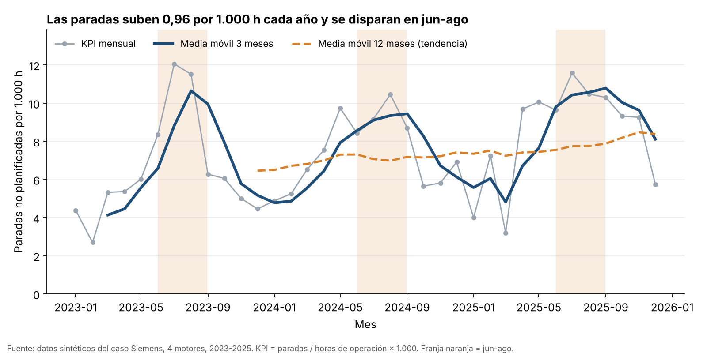
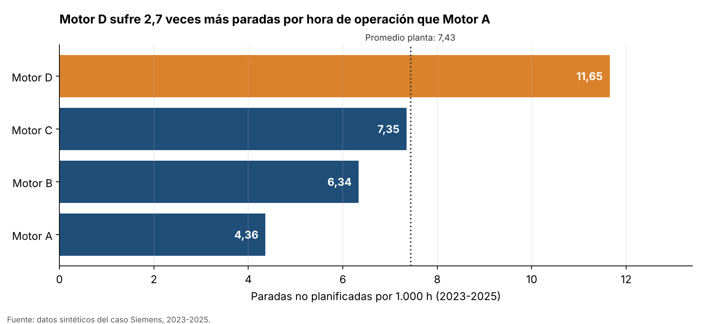

# c3-activity — Análisis temporal y visualización

| | |
|---|---|
| **Estudiante** | Cristhian Gaitán Guzmán |
| **Curso** | Ciencia de Datos (Cód. 69109) · Pénsum 40D · Grupo 1 |
| **Institución** | Facultad de Ingeniería, Corporación Universitaria del Huila (CORHUILA) |
| **Docente** | Jesús Ariel González Bonilla |
| **Actividad** | c3-activity · Corte 3, semana 14 · valor 5.0 |
| **Cierre** | Domingo 8 de noviembre de 2026, 23:59 |
| **Carpeta de entrega** | `14-week/c3-activity/` |

## Correspondencia con el enunciado

| # | Pide el enunciado | Dónde está |
|---|---|---|
| 1 | Serie temporal con `resample` + media móvil; tendencia y estacionalidad | Sección 2 · `analisis_temporal.py` · `data/kpi_mensual.csv` |
| 2 | Dos visualizaciones (evolución y comparación), título con conclusión, ejes honestos | Sección 3 · `img/01_evolucion_kpi.png`, `img/02_comparacion_motores.png` |
| 3 | Optimizar una consulta SQL y explicar la mejora | Sección 4 · `sql/consulta_antes.sql`, `sql/consulta_despues.sql` |
| 4 | Sección **Findings** en inglés (mínimo 5 oraciones) | Sección 5 |

## 1. Caso y datos

Se mantiene el caso del curso: **mantenimiento predictivo de motores industriales en una planta tipo Siemens**. La pregunta de esta entrega es temporal: *¿cómo evolucionan las paradas no planificadas mes a mes, hay tendencia o estacionalidad, y qué motor pesa más?*

Los datos son **sintéticos (ilustrativos)**, generados con semilla fija en `generar_datos.py`: 4.384 lecturas diarias de 4 motores (Motor A–D) entre 2023-01-01 y 2025-12-31, con temperatura, vibración, horas de operación y paradas no planificadas. Reglas de realismo: la temperatura sube a mitad de año, más temperatura implica más paradas, los motores se desgastan (la tasa base sube ≈12 % por año) y el Motor D es el más antiguo. No se reutilizan datos de talleres ni parciales.

**KPI:** paradas no planificadas por cada 1.000 horas de operación = Σ paradas ÷ Σ horas × 1.000. Se suman numerador y denominador por separado antes de dividir (no se promedian razones diarias), igual que la lección de la tasa de defectos de la semana 9.

## 2. Serie temporal: `resample` + media móvil

Con la fecha como índice, `resample("MS")` agrupa lo diario en 36 meses y `rolling()` calcula dos medias móviles: **3 meses** (suaviza el ruido; es *trailing*, por eso sus picos se ven algo desplazados a la derecha) y **12 meses** (aísla la tendencia sin estacionalidad).

**Tendencia.** El KPI medio anual pasa de 6,46 (2023) a 7,42 (2024) y 8,38 (2025): **+0,96 paradas por 1.000 h cada año**. Esa misma cifra sale de una regresión sobre los 36 meses que controla el mes calendario, y la media móvil de 12 meses sube de forma sostenida, coherente con el desgaste acumulado.

> **Por qué no se usa la pendiente simple (1,11).** Una recta ajustada directamente a los 36 meses da +1,11, pero esa cifra está inflada: dentro de cada año el KPI sube de enero a julio, y la recta confunde esa forma estacional con tendencia. Al controlar el mes calendario la pendiente baja a +0,96, que coincide con la diferencia entre promedios anuales.

**Estacionalidad.** El patrón se repite los tres años. El índice por mes calendario se calcula sobre el KPI **dividido por la tendencia** (para que el alza anual no sesgue el resultado): **julio (1,49) y agosto (1,46)** son los picos y **enero (0,64)** el valle. El KPI mensual se correlaciona 0,79 con la temperatura media del mes, así que el calor es el candidato natural para explicar el ciclo. Correlación no es causalidad; aquí además es consecuencia de cómo se simularon los datos. Con solo tres ciclos anuales, el índice es indicativo, no una estimación definitiva.

## 3. Dos visualizaciones

| Evolución | Comparación |
|---|---|
|  |  |

**`img/01_evolucion_kpi.png`** — Líneas, porque el eje X es tiempo continuo. Título con la conclusión, eje Y desde 0, tres series con leyenda (mensual en gris, media de 3 meses resaltada, media de 12 meses como tendencia), franja naranja en jun-ago y fuente al pie.

**`img/02_comparacion_motores.png`** — Barras horizontales ordenadas, porque se comparan categorías sin orden natural. Barras **desde cero**, valores dentro de la barra, línea punteada con el promedio de planta y color de énfasis solo en el motor crítico. Conclusión en el título: **Motor D sufre 2,7 veces más paradas por hora que Motor A** (11,65 frente a 4,36; promedio de planta 7,43).

## 4. Optimización de consulta SQL

Pregunta: *KPI mensual por motor durante 2025.*

**Antes** (`sql/consulta_antes.sql`):
1. Lee todas las columnas con `SELECT *` en una subconsulta, aunque solo usa cuatro.
2. Filtra con `HAVING mes LIKE '2025-%'`, es decir, después de calcular el mes de cada fila, en lugar de filtrar con `WHERE` antes de agrupar.
3. Sin un filtro directo sobre `fecha`, ningún índice puede ayudar.

**Después** (`sql/consulta_despues.sql`):
1. Pide solo las columnas necesarias.
2. Filtra primero con `WHERE fecha >= '2025-01-01' AND fecha < '2026-01-01'` (rango, sin función sobre la columna), así solo se agrupan 1.460 de las 4.384 filas.
3. Crea un **índice cubriente** `(fecha, motor, paradas_no_planificadas, horas_operacion)`: la consulta se resuelve leyendo solo el índice.

**Evidencia.** Ambas versiones devuelven exactamente las mismas filas (el script lo comprueba con un `assert`). Tiempos como **mediana** de 9 tandas; cambian algo de una ejecución a otra, por eso se redondean (salida completa en `salida_ejecucion.txt`).

| Escenario | Versión | Plan de SQLite | Mediana |
|---|---|---|---|
| Tabla real (4.384 filas) | Antes | `SCAN lecturas` | ≈ 2,1 ms |
| | Reescrita, sin índice | `SCAN lecturas` | ≈ 1,0 ms |
| | Reescrita + índice cubriente | `SEARCH … USING COVERING INDEX` | ≈ 1,0 ms (0,9–1,1) |
| Prueba a escala (263.040 filas) | Antes | `SCAN lecturas` | ≈ 140 ms |
| | Reescrita, sin índice | `SCAN lecturas` | ≈ 78 ms |
| | Reescrita + índice cubriente | `SEARCH … USING COVERING INDEX` | ≈ 63 ms |

**Lectura de los resultados.**
- La mejora total es de **alrededor de 2×**, y se mantiene al pasar de 4 mil a 263 mil filas.
- La mayor parte (≈ 1,8×–2,1×) viene de la **reescritura** (columnas necesarias y `WHERE` en lugar de `HAVING`). El plan sigue siendo `SCAN` en ambas versiones, por lo que esa ganancia se demuestra con el tiempo medido y no con el plan.
- El **índice cubriente** cambia el plan de `SCAN` a `SEARCH`. En la tabla real de 4.384 filas no produce una diferencia medible (queda dentro del ruido de la medición); a 263 mil filas sí aporta alrededor de 20 % adicional. Es lo esperable: el índice rinde cuando la tabla es grande.
- La mejora no crece con el tamaño porque 2025 es una tercera parte de los datos. Si la consulta filtrara un mes o un trimestre, el índice evitaría leer una fracción mucho menor de la tabla y la ventaja sería mayor.

## 5. Findings

The synthetic series covers 36 months of unplanned stops per 1,000 operating hours for four industrial motors, aggregated with `resample` and smoothed with 3-month and 12-month moving averages. The trend is clearly upward: the yearly average rises from 6.46 in 2023 to 7.42 in 2024 and 8.38 in 2025, about +0.96 stops per 1,000 hours each year once the seasonal pattern is controlled for, which is consistent with cumulative wear. There is also a strong seasonal pattern that repeats every year, with peaks in July and August (seasonal index of about 1.49 and 1.46 after removing the trend) and a low in January (about 0.64). Monthly stops are correlated with average temperature (r = 0.79), so the hot season is the most likely driver, although this is correlation and not proof of causation. The first chart shows this evolution, with the grey monthly line, the highlighted 3-month average, and the 12-month average revealing the slow upward trend, while the shaded June–August bands mark the high season. The second chart compares motors using bars that start at zero, and it shows that Motor D has 2.7 times more stops per operating hour than Motor A (11.65 versus 4.36), well above the plant average of 7.43. Together, the charts suggest prioritizing preventive maintenance on Motor D and scheduling it before the mid-year peak.

## 6. Conclusión

La actividad lleva el caso Siemens al terreno del tiempo: ya no solo se pregunta *qué motor* falla más (comparación), sino *cuándo* y *si empeora* (tendencia y estacionalidad). Conecta con la semana 9 (KPI con totales, no con promedios de razones), la semana 11 (`resample` y media móvil) y la semana 12 (título que dice la conclusión y ejes honestos). La recomendación es priorizar el Motor D y adelantar el mantenimiento preventivo antes de la temporada alta (jun-ago).

## Estructura de la carpeta

```
14-week/c3-activity/
├── README.md
├── requirements.txt
├── .gitignore
├── generar_datos.py        # genera el CSV sintético (semilla fija)
├── analisis_temporal.py    # resample, medias móviles, gráficos y optimización SQL
├── salida_ejecucion.txt    # salida completa de la última ejecución
├── data/
│   ├── lecturas_motores.csv
│   └── kpi_mensual.csv
├── img/
│   ├── 01_evolucion_kpi.png
│   └── 02_comparacion_motores.png
└── sql/
    ├── consulta_antes.sql
    └── consulta_despues.sql
```

Para reproducir: `pip install -r requirements.txt`, luego `python generar_datos.py` y `python analisis_temporal.py` (SQLite viene con Python).

## Referencias

[1] The pandas development team, "pandas documentation: Resampling and rolling windows," 2026. [Online]. Available: https://pandas.pydata.org/docs/

[2] SQLite Consortium, "The SQLite Query Planner" and "EXPLAIN QUERY PLAN." [Online]. Available: https://www.sqlite.org/queryplanner.html

[3] A. Kanawaday and A. Sane, "Machine learning for predictive maintenance of industrial machines using IoT sensor data," in *Proc. 8th IEEE Int. Conf. Software Engineering and Service Science (ICSESS)*, 2017, pp. 87–90.
